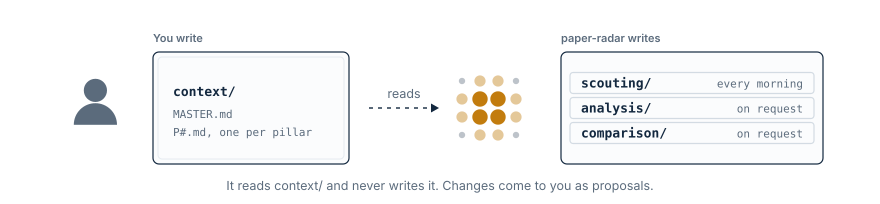
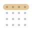
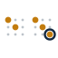

<a href="https://lastnamesong.github.io/paper-radar/"><picture><source media="(prefers-color-scheme: dark)" srcset="assets/hero-ko-dark.svg"></picture></a>

[English](README.md) · **한국어**

<b>무엇인가</b> — 웨어러블 로보틱스와 촉각 정밀 조작 연구를 위한 도구

 

**paper-radar**는 하나의 연구 주제, 즉 몸과 손이 접촉을 어떻게 감지하고 그에
따라 움직이는가를 위한 논문 레이더입니다. 매주 수요일과 토요일 아침에 예약된
[Claude Code](https://claude.com/claude-code) 루틴이 arXiv와 Semantic
Scholar에서 최근 2주의 논문을 훑고, `context/`에 적힌 열린 결정들을 기준으로
점수를 매긴 뒤, 연구 분야마다 한국어 리포트를 하나씩 커밋합니다.
[읽기 사이트](https://lastnamesong.github.io/paper-radar/)가 이를 게시합니다.

| 연구 분야 | 다루는 범위 |
|---|---|
| **P0** — Wearable Robots, Sensors & Biomechanics | 외골격·엑소슈트, 보조력 제어, 웨어러블 센싱(IMU, EMG, 인솔 압력, e-skin), 의도·보행 추정, 인체 생체역학(관절 동역학, 근골격 모델링, 대사 비용) |
| **P1** — Tactile Sensing & Dexterous Manipulation | 비전 기반·어레이·e-skin 촉각 센서, vision-tactile-language-action(VTLA) 정책, 다지 손의 in-hand 조작 |

리포트는 `scouting/P0/`와 `scouting/P1/`에 쌓이고, 끝까지 읽을 가치가 있는
논문은 `analysis/`의 리라이트가 됩니다.

<b>왜 paper-radar인가</b> — arXiv의 홍수에서 다음 아이디어까지

 

| 없을 때 | paper-radar와 함께 |
|---|---|
| 제목 백 개를 훑고 하나도 기억 못 함 | **Scouting** — 내 열린 결정에 묶인, 점수 매긴 몇 편 |
| "나중에 읽어야지" → 영영 안 읽음 | **Analysis** — 한 번에 끝까지 읽히는 한국어 페이지 |
| 같은 성능 향상을 주장하는 논문 세 편 | **Comparison** — 서로 갈라지는 지점만 |
| "누군가 이미 해 봤겠지" | **Ideation** — 아직 안 해 본 아이디어와, 그것을 반박하는 방법 |

모든 리라이트는 초록이 아니라 arXiv 원문에서 출발합니다. 모든 판단은 내 연구
분야와 Decision Log를 기준으로 내립니다. 그리고 전부 한국어로, 읽기 사이트에 함께
게시됩니다.

<b>작동 방식</b> — 맥락은 내가 쓰고, 나머지는 에이전트가 씁니다

 

<picture><source media="(prefers-color-scheme: dark)" srcset="assets/own-dark.svg"></picture>

`context/MASTER.md`는 연구 분야를 가로지르는 내용을, 각 `context/P#.md`는 한
연구 분야의 Decision Log, 추적 문헌, 제외 주제(anti-topics)를 담습니다.

| 트랙 | [Claude Code](https://claude.com/claude-code)에서 실행 | 결과물 |
|:---:|---|---|
| <picture><source media="(prefers-color-scheme: dark)" srcset="assets/track-scouting-dark.svg"></picture> <b>Scouting</b> | 예약 실행, 한 번에 모든 연구 분야 — [설정](scouting/SETUP.md) · `/scout [areas]` | `scouting/P#/<date>.md`와 `scouting/runs/<date>.md` — [형식](scouting/AUTHORING.md) |
| <picture><source media="(prefers-color-scheme: dark)" srcset="assets/track-analysis-dark.svg"></picture> <b>Analysis</b> | `/analyze <arXiv id>`, 이어서 원문·코드와 대조하는 반복 검수 `/proofread <id>` | `analysis/<id>.md` — [형식](analysis/AUTHORING.md) |
| <picture><source media="(prefers-color-scheme: dark)" srcset="assets/track-comparison-dark.svg"></picture> <b>Comparison</b> | `/compare <id> <id> [<id>]` | `comparison/<slug>.md` — [형식](comparison/AUTHORING.md) |
| <picture><source media="(prefers-color-scheme: dark)" srcset="assets/track-ideation-dark.svg"></picture> <b>Ideation</b> | `/ideate [<id \| alias \| topic>]` | 레포에는 아무것도 남지 않음 — 채팅 답변과, 답을 적는 비공개 페이지 |

<b>기본 원칙</b> — 자동화하기 전에 알아둘 것

 

- **손으로 먼저 시작합니다.** 리포트 하나를 엄격하게 검토한 *다음에* 예약을 겁니다.
- **논문은 내가 고릅니다.** 리포트가 저절로 `analysis/`로 넘어가지 않습니다.
- **arXiv HTML이 없으면 리라이트도 없습니다.** 초록만으로는 절대 쓰지 않습니다.
- **리라이트가 먼저입니다.** `/compare`는 `/analyze`가 쓴 것을 읽습니다.

---

[jonghochoi/probe](https://github.com/jonghochoi/probe)(MIT License, Copyright (c) 2026 jonghochoi)에서 파생했습니다. 연구 분야, 맥락, 용어를 웨어러블 로보틱스와 촉각 정밀 조작에 맞게 바꿨습니다.
관리: [Eunseok Song](https://www.linkedin.com/in/eunseok-song/).
