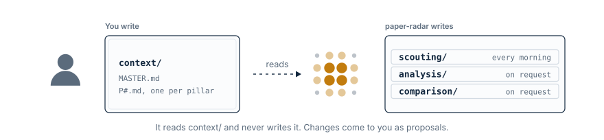
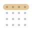
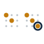

# paper-radar

**English** · [한국어](README.ko.md)

A literature radar for wearable robotics and tactile dexterous manipulation —
scouted every morning, read in Korean.

**[Open the reading site →](https://lastnamesong.github.io/paper-radar/)**

<b>What this is</b> — a research tool for wearable robotics and tactile dexterous manipulation

 

**paper-radar** is the literature radar for one research program: how a body
or a hand senses contact and acts on it. Every morning a scheduled
[Claude Code](https://claude.com/claude-code) routine sweeps arXiv and
Semantic Scholar for the last two weeks of papers, scores them against the
open decisions in `context/`, and commits one Korean report per pillar. The
[reading site](https://lastnamesong.github.io/paper-radar/) publishes them.

| Pillar | Covers |
|---|---|
| **P0** — Wearable Robots & Sensors | Exoskeletons and exosuits, assistance control, wearable sensing (IMU, EMG, insole pressure, e-skin), intent and gait estimation |
| **P1** — Tactile Sensing & Dexterous Manipulation | Vision-based, array and e-skin tactile sensors, vision-tactile-language-action (VTLA) policies, multi-fingered in-hand manipulation |

The reports land in `scouting/P0/` and `scouting/P1/`; the papers worth a full
read become rewrites in `analysis/`.

<b>Why paper-radar</b> — from the arXiv flood to your next idea

 

| Without it | With paper-radar |
|---|---|
| Skim a hundred titles, remember none | **Scouting** — a few scored papers, tied to your open decisions |
| "I'll read it later" → never | **Analysis** — a Korean page you finish in a sitting |
| Three papers, the same claimed win | **Comparison** — only where they part |
| "Surely someone has tried this" | **Ideation** — the untried idea, and how to refute it |

Every rewrite starts from the arXiv original, not the abstract. Every judgement
is made against your own pillars and Decision Log. All of it publishes
together, in Korean, on the reading site.

<b>How it works</b> — you own the context, the agent writes the rest

 

<picture><source media="(prefers-color-scheme: dark)" srcset="assets/own-dark.svg"></picture>

`context/MASTER.md` holds what cuts across pillars, and each `context/P#.md`
holds one pillar's decision log, tracked literature and anti-topics.

| Track | You run in [Claude Code](https://claude.com/claude-code) | It writes |
|:---:|---|---|
| <picture><source media="(prefers-color-scheme: dark)" srcset="assets/track-scouting-dark.svg"></picture> <b>Scouting</b> | scheduled, every pillar in one run — [setup](scouting/SETUP.md) · `/scout [pillars]` | `scouting/P#/<date>.md` and `scouting/runs/<date>.md` — [format](scouting/AUTHORING.md) |
| <picture><source media="(prefers-color-scheme: dark)" srcset="assets/track-analysis-dark.svg"></picture> <b>Analysis</b> | `/analyze <arXiv id>`, then `/proofread <id>` for looped passes against the original and its code | `analysis/<id>.md` — [format](analysis/AUTHORING.md) |
| <picture><source media="(prefers-color-scheme: dark)" srcset="assets/track-comparison-dark.svg"></picture> <b>Comparison</b> | `/compare <id> <id> [<id>]` | `comparison/<slug>.md` — [format](comparison/AUTHORING.md) |
| <picture><source media="(prefers-color-scheme: dark)" srcset="assets/track-ideation-dark.svg"></picture> <b>Ideation</b> | `/ideate [<id \| alias \| topic>]` | nothing in the repo — a chat answer, and a private page you answer on |

<b>Ground rules</b> — what to know before you automate

 

- **Start by hand.** One report, reviewed ruthlessly, *then* the schedule.
- **You name the papers.** A report never feeds `analysis/` on its own.
- **No arXiv HTML, no rewrite.** Never written from the abstract.
- **The rewrite comes first.** `/compare` reads what `/analyze` wrote.

---

Derived from [jonghochoi/probe](https://github.com/jonghochoi/probe) (MIT License, Copyright (c) 2026 jonghochoi). Pillars, context and terminology are adapted to wearable robotics and tactile dexterous manipulation.
Maintained by [Eunseok Song](https://www.linkedin.com/in/eunseok-song/).
